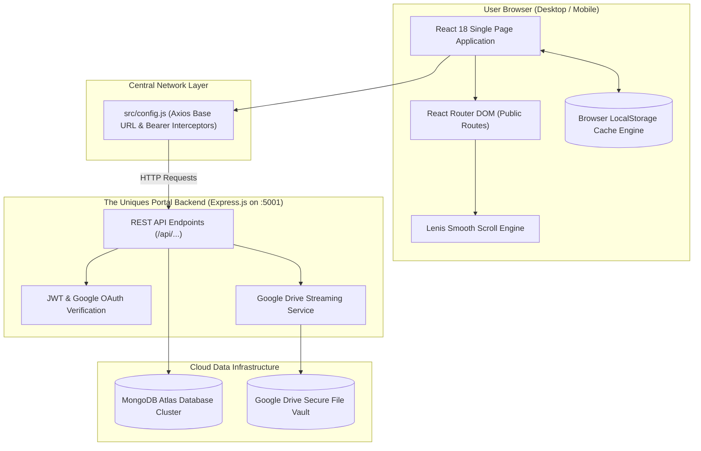
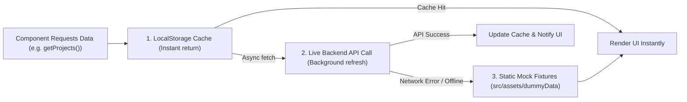

# System Architecture Overview: The Uniques Community

This document explains the overarching system architecture, network interactions, rendering pipeline, and data caching strategies for **The Uniques Community Website** (`theuniquescommunity`).

---

## 1. System Vision & Architecture

The Community Website is the public-facing flagship web presence of **The Uniques**. While the internal **Portal** (`The-Uniques-Portal`) serves as an authenticated management workspace for student task tracking and administrative operations, the **Community Website** acts as the high-impact public showcase for recruiters, prospective students, and industry partners.

---

## 2. Decoupled Monorepo Architecture

The Community Website and the Backend Server are completely decoupled:
1. **Zero Direct Code Imports**: The frontend does not import any modules, schemas, or models from the server directory at compile time.
2. **REST API Contract**: All communication occurs over HTTP requests using `BASE_URL` defined in [`src/config.js`](file:///run/media/jimfleax/DEV/Projects/theuniquescommunity/src/config.js).
3. **Environment Dynamic Resolution**:
   - In local development: `VITE_API_BASE_URL` targets `http://localhost:5001`.
   - In production: defaults to `https://the-uniques-portal.vercel.app`.
   - Cross-site portal links target `PORTAL_URL` (`https://the-uniques-portal.vercel.app`).

---

## 3. Resilient Offline-First Data Strategy

To ensure zero downtime, fast initial paint times, and graceful offline browsing, the community website employs a **three-tier resilience pipeline**:

### Cache Key Inventory:
Managed via [`src/utils/cache/`](file:///run/media/jimfleax/DEV/Projects/theuniquescommunity/src/utils/cache):
- `tu_community_batch_profiles`: Cached cohort profiles (titles, descriptions, group photos).
- `tu_community_member_batches`: Cached list of canonical batch names.
- `tu_community_projects`: Cached student project showcase records.
- `tu_community_stats`: Cached headline numbers (students trained, projects delivered, placements).

---

## 4. Google Drive Image Streaming & Optimization

Student avatars, project thumbnails, and event photos are stored in Google Drive:
1. **Security & Rate-Limiting**: Google Drive does not allow unlimited raw image embeds. Direct client links frequently trigger CORS blocks or rate limits.
2. **Proxy Endpoint**: The backend provides `GET /api/image-proxy/:fileId` ([`googleDriveService.js`](file:///run/media/jimfleax/DEV/Projects/The-Uniques-Portal/server/controller/googleDriveService.js)), which streams image bytes securely using service account credentials.
3. **Helper Pipeline**: [`src/utils/imageHelper.js`](file:///run/media/jimfleax/DEV/Projects/theuniquescommunity/src/utils/imageHelper.js) intercepts file references and routes them through the proxy, while falling back to `ui-avatars.com` if a member profile has no uploaded photo.

---

## 5. Performance & Viewport Architecture

To maintain smooth 60fps animations across rich graphical banners, 3D tilt cards, and particle physics:
- **Lazy Chunking**: Routes and heavy modal dialogs are split into separate bundles using [`src/utils/lazyWithRetry.js`](file:///run/media/jimfleax/DEV/Projects/theuniquescommunity/src/utils/lazyWithRetry.js) with auto-retry logic for network dropouts.
- **Viewport Visibility**: [`src/components/LazyViewport.jsx`](file:///run/media/jimfleax/DEV/Projects/theuniquescommunity/src/components/LazyViewport.jsx) defers rendering DOM nodes below the fold until the user scrolls within 200px of them.
- **Scroll Hijack Isolation**: Modals, tables, and dropdowns use `data-lenis-prevent="true"` to prevent conflicts with the global Lenis smooth scrolling engine.
