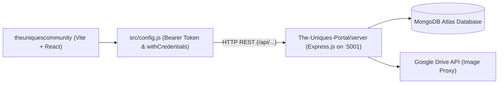

# Frontend to Backend API Endpoint & Schema Mapping

This document provides a comprehensive technical contract mapping every network request initiated by the **The Uniques Community Frontend** (`theuniquescommunity`) to the corresponding backend handlers, database models, request payloads, and response shapes in **The Uniques Portal Backend** (`The-Uniques-Portal/server`).

---

## 1. Overview & Network Topology

The community website acts as the public-facing flagship web application. It connects to the backend REST API via `BASE_URL` defined in [`src/config.js`](file:///run/media/jimfleax/DEV/Projects/theuniquescommunity/src/config.js), which defaults to:
- Local development: `http://localhost:5001`
- Cloud production: `https://the-uniques-portal.vercel.app`



---

## 2. Master Endpoint Directory & Contract Mapping

### 2.1. Authentication & Password Reset

#### `POST ${BASE_URL}/auth/emaillogin`
- **Frontend Caller**: [`src/views/Authentication/login/index.jsx`](file:///run/media/jimfleax/DEV/Projects/theuniquescommunity/src/views/Authentication/login/index.jsx)
- **Backend Handler**: [`server/controller/Authentication/auth.controller.js` -> `emailLogin`](file:///run/media/jimfleax/DEV/Projects/The-Uniques-Portal/server/controller/Authentication/auth.controller.js)
- **Database Model**: `User` (`server/models/user/userModel.js`)
- **Request Body**:
  ```json
  {
    "email": "student@sviet.ac.in",
    "password": "userPlainPassword"
  }
  ```
- **Response Shape (200 OK)**:
  ```json
  {
    "token": "eyJhbGciOiJIUzI1NiIsInR5cCI6IkpXVCJ9...",
    "user": {
      "_id": "671234567890abcdef123456",
      "name": "Alex Kumar",
      "email": "student@sviet.ac.in",
      "role": "Member",
      "batch": "The Uniques 5.0"
    }
  }
  ```

#### `POST ${BASE_URL}/auth/password-reset/send-otp`
- **Frontend Caller**: [`src/views/Authentication/login/ForgetPassword.jsx`](file:///run/media/jimfleax/DEV/Projects/theuniquescommunity/src/views/Authentication/login/ForgetPassword.jsx)
- **Backend Handler**: [`server/controller/Authentication/passwordReset.controller.js`](file:///run/media/jimfleax/DEV/Projects/The-Uniques-Portal/server/controller/Authentication/passwordReset.controller.js)
- **Request Body**: `{ "email": "student@sviet.ac.in" }`
- **Response Shape (200 OK)**: `{ "success": true, "message": "OTP sent successfully to email" }`

#### `POST ${BASE_URL}/auth/password-reset/verify-otp`
- **Frontend Caller**: [`src/views/Authentication/login/ForgetPassword.jsx`](file:///run/media/jimfleax/DEV/Projects/theuniquescommunity/src/views/Authentication/login/ForgetPassword.jsx)
- **Request Body**: `{ "email": "student@sviet.ac.in", "otp": "123456" }`
- **Response Shape (200 OK)**: `{ "success": true, "resetSessionToken": "session-uuid-token" }`

#### `POST ${BASE_URL}/auth/password-reset/reset-password`
- **Frontend Caller**: [`src/views/Authentication/login/ForgetPassword.jsx`](file:///run/media/jimfleax/DEV/Projects/theuniquescommunity/src/views/Authentication/login/ForgetPassword.jsx)
- **Request Body**: `{ "email": "student@sviet.ac.in", "resetSessionToken": "session-uuid-token", "newPassword": "NewPassword123!" }`
- **Response Shape (200 OK)**: `{ "success": true, "message": "Password updated successfully" }`

---

### 2.2. Cohort Batches & Public Members

#### `GET ${BASE_URL}/api/batches/all` & `GET ${BASE_URL}/api/batches/profiles`
- **Frontend Caller**: [`src/utils/batch/batchesData.js`](file:///run/media/jimfleax/DEV/Projects/theuniquescommunity/src/utils/batch/batchesData.js) & [`src/utils/batch/batchProfilesData.js`](file:///run/media/jimfleax/DEV/Projects/theuniquescommunity/src/utils/batch/batchProfilesData.js)
- **Backend Handler**: [`server/controller/Community/batchController.js` -> `getAllBatches` & `getBatchProfiles`](file:///run/media/jimfleax/DEV/Projects/The-Uniques-Portal/server/controller/Community/batchController.js)
- **Database Model**: `Batch` mapped to collection `batchprofiles` (`server/models/community/batchModel.js`)
- **Single Source of Truth**: Both endpoints derive from the unified `batchprofiles` collection.
- **Response Shape (200 OK)**:
  ```json
  [
    {
      "_id": "670f1a9b4f2c9e0012345678",
      "title": "The Uniques 5.0",
      "label": "The Uniques 5.0",
      "image": "/src/assets/img/About/uniques5.webp",
      "customImage": false,
      "status": "active"
    }
  ]
  ```

#### `GET ${BASE_URL}/api/public/members`
- **Frontend Caller**: [`src/views/Landing/Batches/index.jsx`](file:///run/media/jimfleax/DEV/Projects/theuniquescommunity/src/views/Landing/Batches/index.jsx), [`src/views/Landing/homComponents/Batches.jsx`](file:///run/media/jimfleax/DEV/Projects/theuniquescommunity/src/views/Landing/homComponents/Batches.jsx)
- **Backend Handler**: [`server/controller/landing/memberController.js` -> `getPublicMembers`](file:///run/media/jimfleax/DEV/Projects/The-Uniques-Portal/server/controller/landing/memberController.js)
- **Database Model**: `Member` (`server/models/member/memberModel.js`)
- **Query Params**: `?batch=The+Uniques+5.0&page=1&limit=20`
- **Response Shape (200 OK)**:
  ```json
  {
    "success": true,
    "members": [
      {
        "_id": "670f2b3c4f2c9e0087654321",
        "name": "Jane Doe",
        "rollNumber": "2104501",
        "batch": "The Uniques 5.0",
        "role": "Member",
        "domain": "Full Stack Web Development",
        "profilePic": "1A2B3C_GoogleDriveFileId",
        "skills": ["React", "Node.js", "Docker"],
        "socialLinks": {
          "linkedin": "https://linkedin.com/in/janedoe",
          "github": "https://github.com/janedoe"
        }
      }
    ],
    "total": 45,
    "page": 1,
    "pages": 3
  }
  ```

#### `GET ${BASE_URL}/api/public/members/counts`
- **Frontend Caller**: [`src/views/Landing/Batches/index.jsx`](file:///run/media/jimfleax/DEV/Projects/theuniquescommunity/src/views/Landing/Batches/index.jsx)
- **Backend Handler**: [`server/controller/landing/memberController.js` -> `getPublicMemberCounts`](file:///run/media/jimfleax/DEV/Projects/The-Uniques-Portal/server/controller/landing/memberController.js)
- **Response Shape (200 OK)**:
  ```json
  {
    "success": true,
    "counts": {
      "The Uniques 1.0": 18,
      "The Uniques 2.0": 24,
      "The Uniques 3.0": 32,
      "The Uniques 4.0": 40,
      "The Uniques 5.0": 45,
      "The Uniques 6.0": 52
    }
  }
  ```

---

### 2.3. Community Events & Registrations

#### `GET ${BASE_URL}/api/events`
- **Frontend Caller**: [`src/views/Landing/Event/Index.jsx`](file:///run/media/jimfleax/DEV/Projects/theuniquescommunity/src/views/Landing/Event/Index.jsx), [`src/views/Landing/homComponents/Highlight.jsx`](file:///run/media/jimfleax/DEV/Projects/theuniquescommunity/src/views/Landing/homComponents/Highlight.jsx)
- **Backend Handler**: [`server/controller/events/eventController.js` -> `getEvents`](file:///run/media/jimfleax/DEV/Projects/The-Uniques-Portal/server/controller/events/eventController.js)
- **Database Model**: `Event` (`server/models/community/eventModel.js`)
- **Query Params**: `?status=upcoming&limit=10`
- **Response Shape (200 OK)**:
  ```json
  {
    "success": true,
    "events": [
      {
        "_id": "670f55554f2c9e0011223344",
        "title": "HackUniques 2026",
        "description": "36-hour flagship national hackathon",
        "date": "2026-11-15T09:00:00.000Z",
        "venue": "SVVIET Main Auditorium",
        "status": "upcoming",
        "image": "https://lh3.googleusercontent.com/d/1XyZ...",
        "organizingBatch": "The Uniques 5.0",
        "registrationOpen": true
      }
    ]
  }
  ```

#### `GET ${BASE_URL}/api/events/:id`
- **Frontend Caller**: [`src/views/Landing/Event/Componant/EventDetailPage.jsx`](file:///run/media/jimfleax/DEV/Projects/theuniquescommunity/src/views/Landing/Event/Componant/EventDetailPage.jsx)
- **Backend Handler**: [`server/controller/events/eventController.js` -> `getEventById`](file:///run/media/jimfleax/DEV/Projects/The-Uniques-Portal/server/controller/events/eventController.js)
- **Response Shape (200 OK)**: Detailed event object including agenda items, speaker profiles, and custom registration form schema.

#### `POST ${BASE_URL}/api/events/:id/register`
- **Frontend Caller**: [`src/views/Landing/Event/Componant/EventDetailPage.jsx`](file:///run/media/jimfleax/DEV/Projects/theuniquescommunity/src/views/Landing/Event/Componant/EventDetailPage.jsx)
- **Backend Handler**: [`server/controller/events/eventController.js` -> `registerForEvent`](file:///run/media/jimfleax/DEV/Projects/The-Uniques-Portal/server/controller/events/eventController.js)
- **Request Body**:
  ```json
  {
    "name": "Aarav Sharma",
    "email": "aarav@gmail.com",
    "college": "SVVIET",
    "rollNumber": "2203102",
    "phone": "+91 9876543210"
  }
  ```
- **Response Shape (200 OK)**: `{ "success": true, "message": "Registered successfully", "ticketId": "HACK-2026-904" }`

#### `POST ${BASE_URL}/api/events/:id/form-response`
- **Frontend Caller**: [`src/views/Landing/Event/Componant/EventDetailPage.jsx`](file:///run/media/jimfleax/DEV/Projects/theuniquescommunity/src/views/Landing/Event/Componant/EventDetailPage.jsx)
- **Backend Handler**: [`server/controller/events/eventController.js` -> `submitCustomFormResponse`](file:///run/media/jimfleax/DEV/Projects/The-Uniques-Portal/server/controller/events/eventController.js)
- **Request Body**: `{ "responses": { "tshirtSize": "L", "teamName": "ZeroBug", "diet": "Veg" } }`

---

### 2.4. Success Stories & Placements

#### `GET ${BASE_URL}/api/success-stories` & `GET ${BASE_URL}/api/success-stories/:id`
- **Frontend Caller**: [`src/layout/Landing/successStories/index.jsx`](file:///run/media/jimfleax/DEV/Projects/theuniquescommunity/src/layout/Landing/successStories/index.jsx), [`src/views/Landing/SuccessStories/StudentStory.jsx`](file:///run/media/jimfleax/DEV/Projects/theuniquescommunity/src/views/Landing/SuccessStories/StudentStory.jsx)
- **Backend Handler**: [`server/controller/Community/successStories.controller.js`](file:///run/media/jimfleax/DEV/Projects/The-Uniques-Portal/server/controller/Community/successStories.controller.js)
- **Database Model**: `SuccessStory` (`server/models/community/successStories.model.js`)
- **Response Shape (200 OK)**:
  ```json
  [
    {
      "_id": "670f66664f2c9e0099887766",
      "name": "Rohan Verma",
      "company": "Amazon",
      "package": "44 LPA",
      "role": "Software Development Engineer I",
      "batch": "The Uniques 3.0",
      "quote": "The Uniques gave me practical coding rigour that standard college syllabi couldn't match.",
      "avatar": "/src/assets/img/Success Stories avatars/rohan.webp"
    }
  ]
  ```

#### `GET ${BASE_URL}/api/success-stories/stats`
- **Frontend Caller**: [`src/views/Landing/SuccessStories/HomeContent.jsx`](file:///run/media/jimfleax/DEV/Projects/theuniquescommunity/src/views/Landing/SuccessStories/HomeContent.jsx)
- **Response Shape (200 OK)**: `{ "totalPlacements": 250, "averagePackage": "12.5 LPA", "highestPackage": "54 LPA", "topRecruiters": 65 }`

---

### 2.5. Projects Showcase & Student Portfolios

#### `GET ${BASE_URL}/api/projects`
- **Frontend Caller**: [`src/utils/project/projectsData.js`](file:///run/media/jimfleax/DEV/Projects/theuniquescommunity/src/utils/project/projectsData.js), [`src/views/Landing/Projects/index.jsx`](file:///run/media/jimfleax/DEV/Projects/theuniquescommunity/src/views/Landing/Projects/index.jsx)
- **Backend Handler**: [`server/controller/Community/projectController.js` -> `getProjects`](file:///run/media/jimfleax/DEV/Projects/The-Uniques-Portal/server/controller/Community/projectController.js)
- **Database Model**: `Project` (`server/models/community/projectModel.js`)
- **Response Shape (200 OK)**:
  ```json
  {
    "success": true,
    "projects": [
      {
        "_id": "670f77774f2c9e0033445566",
        "title": "Decentralized Medical Vault",
        "description": "Zero-knowledge encryption for electronic health records.",
        "techStack": ["React", "Solidity", "Node.js", "IPFS"],
        "githubUrl": "https://github.com/the-uniques/med-vault",
        "liveUrl": "https://medvault.theuniques.in",
        "thumbnail": "1DriveFileId_xyz",
        "batch": "The Uniques 5.0"
      }
    ]
  }
  ```

---

### 2.6. Inbound Contact & Partner Inquiries

#### `POST ${BASE_URL}/api/contact`
- **Frontend Caller**: [`src/views/Landing/Contact/components/ContactForm.jsx`](file:///run/media/jimfleax/DEV/Projects/theuniquescommunity/src/views/Landing/Contact/components/ContactForm.jsx)
- **Backend Handler**: [`server/controller/admin/enquiryController.js` -> `submitEnquiry`](file:///run/media/jimfleax/DEV/Projects/The-Uniques-Portal/server/controller/admin/enquiryController.js)
- **Database Model**: `Enquiry` (`server/models/Enquiry/enquiryModel.js`)
- **Request Body**:
  ```json
  {
    "name": "Priya Kapoor",
    "email": "priya@techcorp.com",
    "phone": "+91 9123456780",
    "subject": "Corporate Mentorship Partnership",
    "message": "We would like to conduct weekend AI system workshops with The Uniques 5.0."
  }
  ```
- **Response Shape (200 OK)**: `{ "success": true, "message": "Inquiry submitted successfully. Our team will contact you shortly." }`

---

### 2.7. Google Drive Image Streaming Proxy

#### `GET ${BASE_URL}/api/image-proxy/:fileId`
- **Frontend Caller**: [`src/views/Landing/Batches/components/MemberCard.jsx`](file:///run/media/jimfleax/DEV/Projects/theuniquescommunity/src/views/Landing/Batches/components/MemberCard.jsx)
- **Backend Handler**: [`server/controller/googleDriveService.js` -> `proxyDriveImage`](file:///run/media/jimfleax/DEV/Projects/The-Uniques-Portal/server/controller/googleDriveService.js)
- **Behavior**: Streams raw image buffers directly from Google Drive using service account authentication, returning standard MIME headers (`image/jpeg`, `image/webp`).
- **Why this exists**: Avoids making Google Drive folders public, mitigates Google Drive rate-limits, and prevents CORS blocks in the browser.
