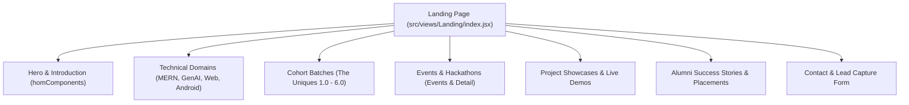

# Views and UI Component Catalog: The Uniques Community

This document details the complete visual layer of **The Uniques Community Website** (`theuniquescommunity`), cataloging all landing sections, showcase pages, dialog modals, cards, and animation components.

---

## 1. Views Overview & Subsystem Organization

---

## 2. Home Landing Page Sections (`src/views/Landing/homComponents/`)

Mounted on the home route (`/`) via [`src/views/Landing/index.jsx`](file:///run/media/jimfleax/DEV/Projects/theuniquescommunity/src/views/Landing/index.jsx):

| Component File | Role & Visual Presentation | Backend API & Data Connections |
| :--- | :--- | :--- |
| [`HomeHero.jsx`](file:///run/media/jimfleax/DEV/Projects/theuniquescommunity/src/views/Landing/homComponents/HomeHero.jsx) | Hero header with animated gradient text, call-to-action button linking to registration, and social icons. | Static and portal links. |
| [`HelloHero.jsx`](file:///run/media/jimfleax/DEV/Projects/theuniquescommunity/src/views/Landing/homComponents/HelloHero.jsx) | Secondary welcoming hero banner introducing the SVVIET community ethos. | Presentation layer. |
| [`Logo.jsx`](file:///run/media/jimfleax/DEV/Projects/theuniquescommunity/src/views/Landing/homComponents/Logo.jsx) | Brand identity badge with glowing SVG border. | Design system. |
| [`LandingStats.jsx`](file:///run/media/jimfleax/DEV/Projects/theuniquescommunity/src/views/Landing/homComponents/LandingStats.jsx) & [`Counts.jsx`](file:///run/media/jimfleax/DEV/Projects/theuniquescommunity/src/views/Landing/homComponents/Counts.jsx) | Animated numerical counters showcasing students trained (500+), projects shipped (120+), and placements (250+). | Consumes [`statsData.js`](file:///run/media/jimfleax/DEV/Projects/theuniquescommunity/src/utils/stats/statsData.js) (`GET ${BASE_URL}/api/stats`). |
| [`Highlight.jsx`](file:///run/media/jimfleax/DEV/Projects/theuniquescommunity/src/views/Landing/homComponents/Highlight.jsx) | Featured spotlight card promoting the latest upcoming flagship hackathon or workshop. | Calls `GET ${BASE_URL}/api/events?limit=1`. |
| [`Batches.jsx`](file:///run/media/jimfleax/DEV/Projects/theuniquescommunity/src/views/Landing/homComponents/Batches.jsx) | Cohort preview slider with student member rosters for `The Uniques 1.0` through `6.0`. | Calls `GET ${BASE_URL}/api/public/members` and `/api/public/members/counts`. |
| [`BlogSection.jsx`](file:///run/media/jimfleax/DEV/Projects/theuniquescommunity/src/views/Landing/homComponents/BlogSection.jsx) | Article preview grid presenting recent technical publications. | Calls `GET ${BASE_URL}/api/blogs?limit=3`. |
| [`Event.jsx`](file:///run/media/jimfleax/DEV/Projects/theuniquescommunity/src/views/Landing/homComponents/Event.jsx) | Interactive events reel displaying upcoming dates, venues, and registration triggers. | Calls `GET ${BASE_URL}/api/events`. |
| [`Placements.jsx`](file:///run/media/jimfleax/DEV/Projects/theuniquescommunity/src/views/Landing/homComponents/Placements.jsx) & [`Startups.jsx`](file:///run/media/jimfleax/DEV/Projects/theuniquescommunity/src/views/Landing/homComponents/Startups.jsx) | Corporate hiring partners (Amazon, Google, Microsoft) and student-founded startups. | Presentation fixtures. |
| [`DomeGallery.jsx`](file:///run/media/jimfleax/DEV/Projects/theuniquescommunity/src/views/Landing/homComponents/DomeGallery.jsx) & [`Gallery.jsx`](file:///run/media/jimfleax/DEV/Projects/theuniquescommunity/src/views/Landing/homComponents/Gallery.jsx) | 3D spherical dome photo gallery showing community hackathon life. | Google Drive proxy and local media. |
| [`YoutubeSection.jsx`](file:///run/media/jimfleax/DEV/Projects/theuniquescommunity/src/views/Landing/homComponents/YoutubeSection.jsx) | Responsive video showcase featuring student keynote speeches and demo days. | YouTube video embed parser. |
| [`TestimonialCard.jsx`](file:///run/media/jimfleax/DEV/Projects/theuniquescommunity/src/views/Landing/homComponents/TestimonialCard.jsx) | Auto-sliding review carousel from student alumni. | Consumes `reviewData.js`. |

---

## 3. Dedicated Domain Showcase Views

### 1. Events & Hackathons (`src/views/Landing/Event/`)
- **[`Index.jsx`](file:///run/media/jimfleax/DEV/Projects/theuniquescommunity/src/views/Landing/Event/Index.jsx)**: Main events catalog with filter tabs (Upcoming, Ongoing, Past) and search input. Calls `GET ${BASE_URL}/api/events`.
- **[`Componant/EventDetailPage.jsx`](file:///run/media/jimfleax/DEV/Projects/theuniquescommunity/src/views/Landing/Event/Componant/EventDetailPage.jsx)**: Full event page rendering speaker schedules, venue details, and registration forms. Calls `GET ${BASE_URL}/api/events/:id` and `POST /api/events/:id/register`.

### 2. Cohort Batches (`src/views/Landing/Batches/`)
- **[`index.jsx`](file:///run/media/jimfleax/DEV/Projects/theuniquescommunity/src/views/Landing/Batches/index.jsx)**: Interactive cohort navigator displaying batch photos, narratives, and student rosters. Calls `GET ${BASE_URL}/api/public/members` and `GET ${BASE_URL}/api/public/members/counts`.
- **[`components/MemberCard.jsx`](file:///run/media/jimfleax/DEV/Projects/theuniquescommunity/src/views/Landing/Batches/components/MemberCard.jsx)**: Student card resolving avatars via `GET ${BASE_URL}/api/image-proxy/:fileId`.

### 3. Student Projects (`src/views/Landing/Projects/`)
- **[`index.jsx`](file:///run/media/jimfleax/DEV/Projects/theuniquescommunity/src/views/Landing/Projects/index.jsx)**: Searchable project directory with filter chips for React, Node, Web3, and Python. Calls `GET ${BASE_URL}/api/projects`.
- **[`ProjectDetails.jsx`](file:///run/media/jimfleax/DEV/Projects/theuniquescommunity/src/views/Landing/Projects/ProjectDetails.jsx)**: Deep specification sheet showcasing live demo URLs, GitHub repository links, and architecture diagrams.

### 4. Alumni Success Stories (`src/views/Landing/SuccessStories/`)
- **[`index.jsx`](file:///run/media/jimfleax/DEV/Projects/theuniquescommunity/src/views/Landing/SuccessStories/index.jsx)**: Alumni placement directory linking company offers and packages. Calls `GET ${BASE_URL}/api/success-stories`.
- **[`StudentStory.jsx`](file:///run/media/jimfleax/DEV/Projects/theuniquescommunity/src/views/Landing/SuccessStories/StudentStory.jsx)**: Individual student interview detailing their journey from beginner to corporate offer. Calls `GET ${BASE_URL}/api/success-stories/:id`.

### 5. Inbound Contact (`src/views/Landing/Contact/`)
- **[`components/ContactForm.jsx`](file:///run/media/jimfleax/DEV/Projects/theuniquescommunity/src/views/Landing/Contact/components/ContactForm.jsx)**: Lead generation form for corporate workshops, sponsorships, and inquiries. Submits `POST ${BASE_URL}/api/contact`.

---

## 4. Reusable UI Atoms & Widgets (`src/utils/`)

| Folder | Key Components | Purpose & Features |
| :--- | :--- | :--- |
| **`Card/`** | `BlogCard`, `BlogCard2`, `HoverCard`, `MemberCard`, `SpotLightCard`, `TitledCard`, `WeirdCard` | Reusable cards featuring 3D spring physics, mouse-follow radial spotlights, and responsive badges. |
| **`Buttons/`** | `Button.jsx`, `HoverButton.jsx` | Brand buttons with animated flare effects and sliding background fills. |
| **`Modal/`** | `Community.jsx`, `ConfirmationModal.jsx`, `ProfileModal.jsx` | Accessible overlays with dark/light theme adaptation and focus locking. |
| **`Loader/`** | `CustomLoader.jsx`, `index.jsx` | Fullscreen brand loader and in-component loading spinners. |
| **`clickSpark/`** | `ClickSpark.jsx` | HTML5 canvas particle explosion effect triggered on user clicks. |
| **`Orbit/`** | `Orbit.jsx` | Concentric planetary orbit animation rotating member avatars around a central brand icon. |
| **`ScrollStack/`** | `ScrollStack.jsx` | Card stacking animation pinning cards sequentially on vertical scroll. |
| **`Timeline/`** | `Timeline.jsx` | Chronological event roadmaps for cohort histories. |
