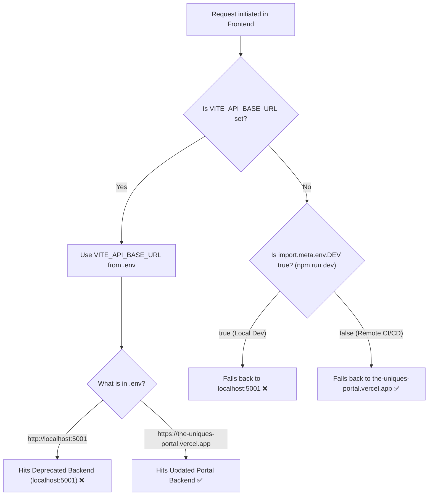
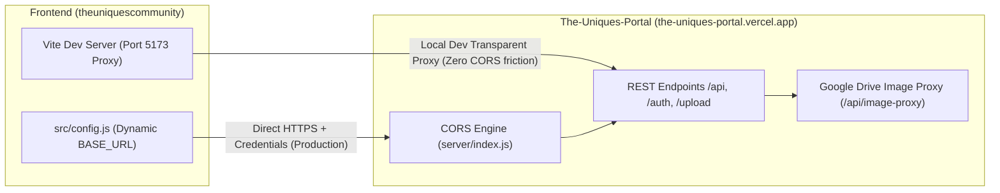

# Migration & Architecture Plan: Decoupling Frontend from Deprecated Backend to `The-Uniques-Portal`

## 1. Executive Context

| Aspect | Current Deprecated Setup | Target Architecture |
| :--- | :--- | :--- |
| **Backend Location** | Local folder `./Backend` in `theuniquescommunity` | Separate standalone repo `../The-Uniques-Portal` |
| **Live Hosting** | None (defunct local server) | Hosted on Vercel at `https://the-uniques-portal.vercel.app` |
| **Frontend Connection** | Hardcoded dev fallback to `localhost:5001` | Dynamic via `VITE_API_BASE_URL` with hosted portal default |
| **CORS Status** | Relies on local Express CORS | Handled dynamically by `The-Uniques-Portal` with credential support |

---

## 2. Current Workflow & Why It Uses the Outdated Backend

### How the Frontend Currently Connects
All HTTP communications flow through [`src/config.js`](../src/config.js#L3-L5):

```javascript
export const BASE_URL =
  import.meta.env.VITE_API_BASE_URL ||
  (import.meta.env.DEV ? "http://localhost:5001" : "https://the-uniques-portal.vercel.app");

axios.defaults.withCredentials = true;
```

### When Does It Use the Outdated vs Updated Backend?



### The Root Causes of Why the Outdated Backend is Still Being Used:

1. **Explicit `.env` Override:**
   The local [`.env`](../.env) file is committed/present with:
   ```env
   VITE_API_BASE_URL=http://localhost:5001
   ```
   Because Vite loads `.env` automatically, `VITE_API_BASE_URL` always resolves to `http://localhost:5001`.

2. **Hardcoded Dev Fallback in `src/config.js`:**
   Even if a developer deletes `.env`, line 5 contains:
   ```javascript
   import.meta.env.DEV ? "http://localhost:5001" : "https://the-uniques-portal.vercel.app"
   ```
   When running `npm run dev`, `import.meta.env.DEV` is `true`. The code forcibly connects to `http://localhost:5001` (the deprecated backend) instead of the hosted portal.

3. **Local `npm run build` Polluted by `.env`:**
   When running `npm run build` locally, Vite loads `.env`. Because `.env` has `localhost:5001`, the compiled `dist/` bundle contains hardcoded references to `localhost:5001`. Only remote CI/CD (GitHub Actions where `.env` is absent) defaulted to `the-uniques-portal.vercel.app`.

---

## 3. Dynamic Environment & CORS Automation Strategy

To completely eliminate the deprecated backend and make fetching and CORS dynamic, we establish a 3-tier architecture:



### 1. Dynamic `BASE_URL` in `src/config.js`
Change the fallback so that **hosted `the-uniques-portal.vercel.app` is the primary target everywhere**, unless explicitly overridden:

```javascript
import axios from "axios";

export const BASE_URL =
  import.meta.env.VITE_API_BASE_URL || "https://the-uniques-portal.vercel.app";

axios.defaults.withCredentials = true;

// Automatically attach JWT token from localStorage if present
axios.interceptors.request.use(
  (config) => {
    const token = localStorage.getItem("token");
    if (token) {
      config.headers = config.headers || {};
      config.headers.Authorization = `Bearer ${token}`;
      config.headers.token = token;
    }
    return config;
  },
  (error) => Promise.reject(error)
);
```

### 2. Vite Dev Server Reverse Proxy (Automating Local CORS)
By adding proxy configuration to [`vite.config.js`](../vite.config.js), local development can proxy `/api`, `/auth`, and `/upload` to the target backend dynamically:

```javascript
import { defineConfig, loadEnv } from 'vite';
import react from '@vitejs/plugin-react';
import path from 'path';

export default defineConfig(({ mode }) => {
  const env = loadEnv(mode, process.cwd(), '');
  const targetBackend = env.VITE_API_BASE_URL || 'https://the-uniques-portal.vercel.app';

  return {
    plugins: [react()],
    resolve: {
      alias: {
        '@': path.resolve(__dirname, 'src')
      }
    },
    server: {
      port: 5173,
      strictPort: false,
      proxy: {
        '/api': {
          target: targetBackend,
          changeOrigin: true,
          secure: false,
        },
        '/auth': {
          target: targetBackend,
          changeOrigin: true,
          secure: false,
        },
        '/upload': {
          target: targetBackend,
          changeOrigin: true,
          secure: false,
        }
      }
    }
  };
});
```
**Why this is advantageous:**
- In local dev, Vite intercepts any relative calls and proxies them with `changeOrigin: true`.
- Zero CORS preflight friction during local development.
- Cookie credentials (`withCredentials: true`) are passed smoothly.

### 3. Verification of `The-Uniques-Portal` CORS Rules
We verified the live CORS implementation on `https://the-uniques-portal.vercel.app`:
- It explicitly allows:
  - `http://localhost:5173` (Vite's default port)
  - `http://localhost:3000`
  - `https://theuniques.in` and all subdomains `*.theuniques.in` (e.g. `community.theuniques.in`)
  - `https://theuniquesportal.vercel.app` & `https://the-uniques-portal.vercel.app`
  - Any origin provided in environment variables `ALLOWED_ORIGINS` or `FRONTEND_URL`.
- It returns:
  - `Access-Control-Allow-Origin: <origin>`
  - `Access-Control-Allow-Credentials: true`
  - `Access-Control-Allow-Headers: Content-Type, Authorization, token, X-Requested-With, Accept, Origin`
  - `Access-Control-Expose-Headers: Content-Type, Authorization, token`

*(Live test confirmed: Preflight `OPTIONS` from `http://localhost:5173` returns HTTP 204 with credentials enabled).*

---

## 4. Step-by-Step Action Plan to Fully Delete `Backend/`

### Step 1: Update Frontend Environment Files
Update [`.env`](../.env) and [`.env.example`](../.env.example):
```env
# Hosted Backend API (The Uniques Portal)
VITE_API_BASE_URL=https://the-uniques-portal.vercel.app

# Optional: To test against a local portal server running at ../The-Uniques-Portal:
# VITE_API_BASE_URL=http://localhost:5001
```

### Step 2: Update `src/config.js`
Replace the fallback:
```javascript
export const BASE_URL =
  import.meta.env.VITE_API_BASE_URL || "https://the-uniques-portal.vercel.app";
```

### Step 3: Update `vite.config.js`
Incorporate `loadEnv` and the `server.proxy` configuration.

### Step 4: Clean Root `package.json`
Remove obsolete backend dependencies from the frontend root:
```bash
npm uninstall express mongoose multer googleapis
```

### Step 5: Delete the Deprecated `Backend/` Directory
Since `../The-Uniques-Portal` already contains the full backend code, database seeds, models, and migrations:
```bash
rm -rf Backend
```

### Step 6: Validate End-to-End
1. Run `npm run build` to confirm the production build passes.
2. Run `npm run dev` and test:
   - Live statistics loading (`/api/stats`)
   - Google Drive image proxying (`/api/image-proxy/:fileId`)
   - Authentication & login flows (`/auth/emaillogin`)
   - Project listings (`/api/projects`)
